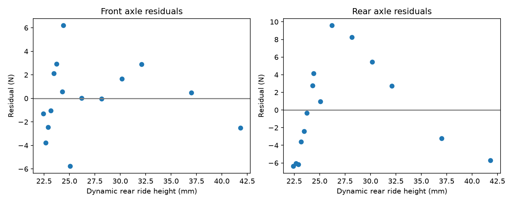

# F1 25 Aero Map Regression

Separates the effects of front and rear ride height on axle downforce in the F1 25 game, using test data from controlled coast-down runs at Mexico City.

## Why regression?
Changing the static ride height at one end of the car also moved the dynamic ride height at the other end. A two-variable linear regression separates the two effects.

## Results (15 test points)
| Axle | Per mm front ride height | Per mm rear ride height | R squared |
|---|---|---|---|
| Front | -42.46 N | +6.05 N | 0.9998 |
| Rear | -14.15 N | -13.40 N | 0.997 |

Leave-one-out cross-validation: the linear model predicts unseen points better (front 4.6 N error) than a quadratic model (6.2 N), so the linear model is kept.



## How to run
```
conda activate aero
python step1_explore.py
python step2_scipy_fit.py
python step3_sklearn_cv.py
python -m pytest
```